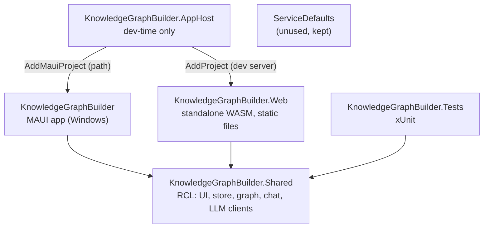
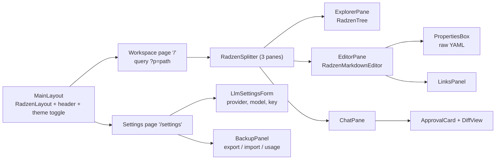
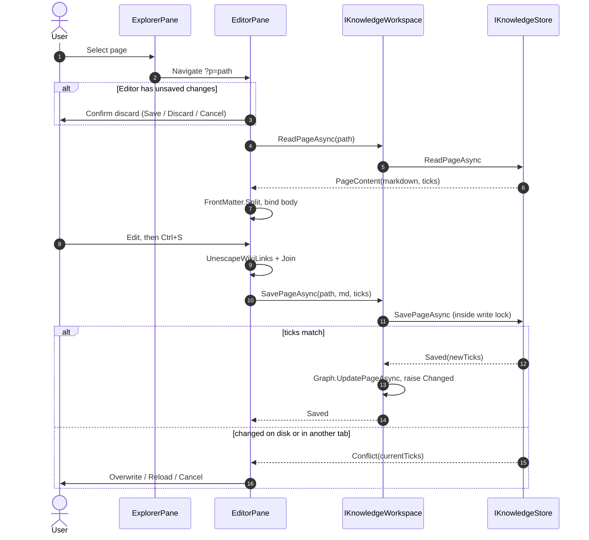
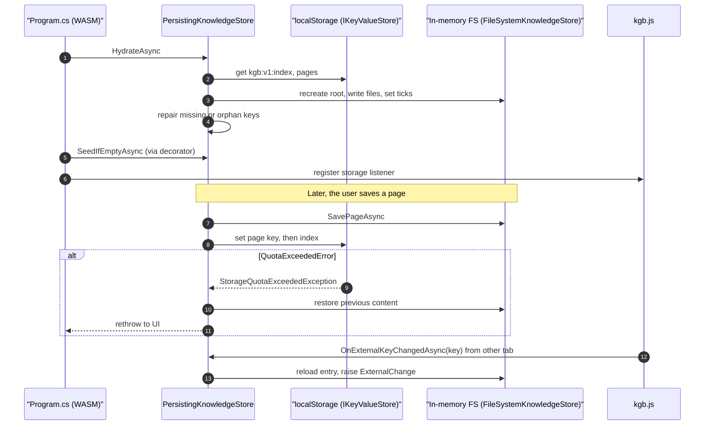
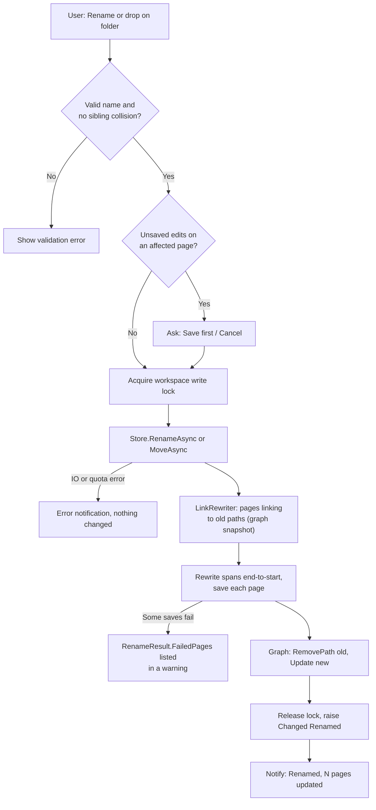
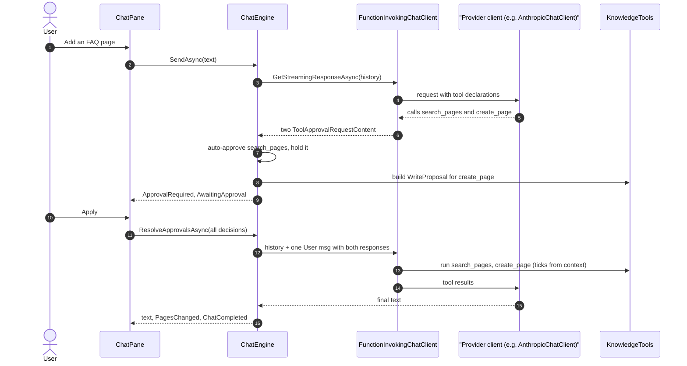
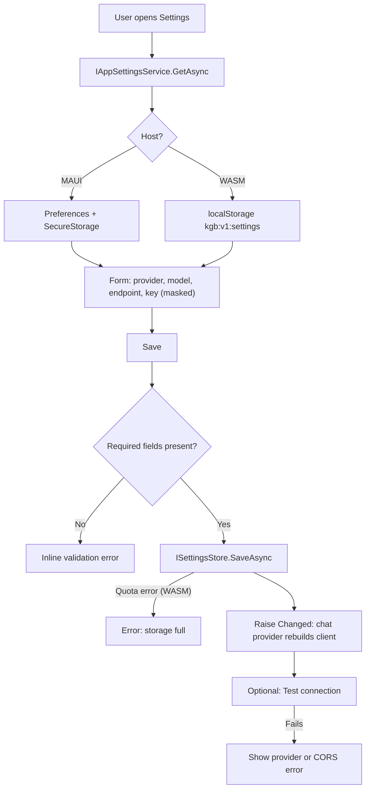

# Knowledge Graph Builder: Implementation Plan

| | |
|---|---|
| Status | Draft for implementation (rev 4: two independent apps, and the WASM app runs entirely in the browser) |
| Date | 2026-11-01 |
| Scope | A knowledge graph made of Markdown pages, with a folder and page explorer, a Markdown editor, and a chat that queries and edits the graph. It ships as a MAUI Windows desktop app and as a server-less Blazor WebAssembly app. |
| Audience | A developer or agent session that has not seen the planning conversation |

---

## 1. Summary

The template MAUI Blazor Hybrid app becomes a **workbench for a knowledge graph of Markdown pages**:

- A **file explorer** (`RadzenTree`) shows nested folders and `.md` pages.
- A **Markdown editor** (`RadzenMarkdownEditor`). YAML front-matter is edited separately, and a **Links panel** lists outgoing links, backlinks and unresolved links.
- A **chat panel** built on the Microsoft.Extensions.AI `IChatClient` with tool calling. It answers from the graph with `[[citations]]`, and it can create or update pages after the user approves a diff.

All of the UI and logic lives in one **Razor Class Library**, `KnowledgeGraphBuilder.Shared`. Two **independent** apps render it, and neither one needs the other or a server:

| App | Where pages live | Where the API key lives | How the LLM is called |
|---|---|---|---|
| MAUI Blazor Hybrid (Windows) | **`Documents\KnowledgeGraphBuilder`** on disk | MAUI `SecureStorage` (DPAPI) | Directly from the app |
| Blazor WebAssembly, **static files only** | **Browser `localStorage`**, one key per page | **Browser `localStorage`** | **Directly from the browser** to the provider. The pattern comes from *AIStoryBuildersOnline*. |

Both apps run the same storage, graph, chat and LLM-client code. In WASM, the working tree is the .NET in-memory file system at `MyDocuments/KnowledgeGraphBuilder`, and every change is written through to `localStorage`.

---

## 2. Goals and non-goals

### Goals

| # | Goal |
|---|---|
| G1 | Create, rename, move and delete nested folders and `.md` pages from a tree. |
| G2 | Edit pages with Radzen's Markdown editor without corrupting front-matter or `[[wiki links]]`. |
| G3 | Backlinks, outgoing links, unresolved links and search. A rename or move rewrites the links that point to the page. |
| G4 | Chat answers from the graph, cites pages, and proposes writes that the user approves with a diff. |
| G5 | One shared UI codebase. The two app projects contain no pages or components. |
| G6 | **Independence.** Each app runs, stores data, and keeps its key and settings on its own. The WASM app is static files that need no server. |
| G7 | No silent overwrites. External edits (MAUI) and edits from another tab (WASM) are detected when saving. |
| G8 | WASM data survives a reload and can be **exported and imported** as a `.zip`. |
| G9 | Aspire stays a **development convenience**. `aspire run` can launch both apps, and neither app needs Aspire at runtime. |

### Non-goals (v1)

| Non-goal | Why |
|---|---|
| Any server, proxy or backend API | The user's rule: WASM runs entirely in the browser |
| Syncing between MAUI and WASM | The apps are independent. Moving content between them is Q3. |
| Accounts or authentication | Single user per device and browser |
| IndexedDB or OPFS storage | The user chose localStorage. The quota risk is R12. |
| Live file watching on MAUI | D5 |
| Persisted chat history | Chat history is kept in memory for the session only |
| Offline PWA install | Not requested. It can be added later because the app is static. |
| Visual graph canvas | Not requested |
| Android, iOS or Mac Catalyst as supported targets | The TFMs stay in the project (D12), but only Windows is accepted |
| Embeddings or vector search | Search uses keyword scoring (R6) |
| A configurable knowledge root | Each app uses a fixed root (D16) |

---

## 3. Decisions

| ID | Decision | Rejected alternative | Why |
|---|---|---|---|
| D1 | Use **`RadzenMarkdownEditor`** (Radzen.Blazor 12.1.x). **Strip front-matter** into a Properties box. **Un-escape `\[\[` back to `[[`** on save. The T3 spike decides whether the editor defaults to Design or Source mode. | A Source-only textarea, or `RadzenHtmlEditor` | The user chose this. Radzen escapes `[`, and it treats `---` front-matter as a horizontal rule plus a heading. Round-tripping through HTML would destroy Markdown fidelity. |
| D2 | The UI and the chat tools talk to **`IKnowledgeWorkspace`**, implemented once as `LocalKnowledgeWorkspace` and used by both apps. | A separate implementation per app | Both apps have their files local to the process: on disk for MAUI, in memory plus localStorage for WASM. |
| D3 | **No server.** The WASM project is a standalone `Microsoft.NET.Sdk.BlazorWebAssembly` app published as static files. Rev 2 and 3 had an ASP.NET Core host, an API guard and an LLM proxy; all of that is removed. | Keep a host or proxy | The user said the WASM app must run entirely in the browser |
| D4 | The AppHost uses **`Aspire.Hosting.Maui`** with `AddMauiProject(...).AddWindowsDevice()`, plus `AddProject` for the WASM dev server. The broken MAUI `ProjectReference` goes away. Neither app references ServiceDefaults, because nothing at runtime depends on Aspire. | Keep `AddProject<Projects.KnowledgeGraphBuilder>` | The user pointed at `AspireDeployService`. Neither app must need Aspire to run (G6). |
| D5 | **Optimistic concurrency.** Reads return `ModifiedTicks` and saves send them back. A mismatch returns `Conflict`, and the user picks Overwrite, Reload or Cancel. All writes go through a single write lock in `LocalKnowledgeWorkspace`. | `FileSystemWatcher`, or last write wins | The user chose this |
| D6 | Chat approval uses MEAI's stable `ApprovalRequiredAIFunction` and `ToolApprovalRequestContent`. Read-only tools are approved automatically. A turn ends with either `Completed` or `AwaitingApproval`, and decisions on *all* pending requests resume it. | A custom "propose" tool | It keeps the model, tool calls and approvals consistent |
| D7 | **LLM calls go directly from the browser, or from the MAUI process, to the provider.** All chat runs locally: `ChatEngine`, `FunctionInvokingChatClient` and the tools. | A server proxy (rev 3) | No server is allowed (D3) |
| D8 | **Everything goes in Shared**, including the LLM client factory. There is no Core project. The factory uses only clients that work in the browser. | A Core library for server-only SDKs | No server is left. Both apps need the same clients. |
| D9 | **Anthropic access is a hand-written `AnthropicChatClient : IChatClient` over `HttpClient`.** It calls the Messages API with streaming and tool use. In the browser it sends `anthropic-dangerous-direct-browser-access: true`, which is the CORS opt-in. Both apps use it. | The official `Anthropic` SDK (13.3.0) | AIStoryBuildersOnline avoided the SDK in WASM because of "SocketsHttpHandler and CORS issues". One client for both apps keeps the behavior identical. |
| D10 | Drop Bootstrap and use Radzen for layout and theme. | Keep both | They conflict, for example on `.btn-primary` and `.table` in [app.css](../KnowledgeGraphBuilder/wwwroot/app.css) |
| D11 | `<RadzenTheme>` and `RadzenAppearanceToggle` go in the shared `MainLayout`. | `HeadContent` with `HeadOutlet` | MAUI has no `HeadOutlet`. Whether the toggle works from there is **(assumed)**; verify in T2. If it doesn't, fall back to a static `<link>` and set `CanToggleTheme=false`. |
| D12 | Keep the other MAUI TFMs. Build and accept with `-f net10.0-windows10.0.19041.0`. | Windows-only | The brief keeps them. R2 is the fallback. |
| D13 | **WASM page storage** uses **one `localStorage` key per page** holding the raw Markdown, plus an **index key** for folders and ticks. The `PersistingKnowledgeStore` decorator writes through to localStorage, and a hydrator rebuilds the in-memory file system at startup. | Re-zip the whole tree into one base64 key, as AIStoryBuildersOnline does | Writing one key per change avoids rewriting the whole tree and about 33% base64 overhead. It also doesn't depend on unreliable unload saves, and it lets other tabs detect changes per key. |
| D14 | Graph queries are **async** (`IKnowledgeGraphQuery`). Index mutation is a separate interface (`IKnowledgeGraphIndex`). | The brief's synchronous methods | Stable UI contract. Only the workspace mutates the index. |
| D15 | Deletes go through **`IFileDeleter`**. MAUI uses the **Windows Recycle Bin**. WASM deletes permanently, and the confirmation offers **Export first**. The confirmation also counts hidden and non-`.md` files. | Delete permanently everywhere | The tree hides `.git`, images and other non-page files |
| D16 | **Fixed roots.** Both apps use `Path.Combine(Environment.GetFolderPath(SpecialFolder.MyDocuments), "KnowledgeGraphBuilder")`. In WASM this path is inside the in-memory file system. MAUI Settings shows the root read-only, with an **Open folder** button. | A root that can be changed at runtime | The user specified the location |
| D17 | Chat Markdown renders **without images**, and external links are inert. | Render as-is | Stops prompt-injection exfiltration. This matters more now that the API key lives in the same browser origin. |
| D18 | **Changes from other tabs:** a `storage` event listener in `kgb.js` forwards each changed key. The store reloads that entry and raises `ExternalChange`. A save from a stale tab hits the ticks conflict check. | Ignore other tabs | Two tabs would otherwise overwrite each other silently |
| D19 | **Backup (WASM):** Settings has **Export (.zip)** and **Import (.zip)**. Import uses manual `ZipArchive` extraction with a Zip Slip guard, and `InputFile` with `maxAllowedSize = 10 MB`. Downloads go through `DotNetStreamReference` and `saveAsFile`. **The export never includes settings or the API key.** | No backup | Browser data can be cleared, and the quota is small. AIStoryBuilders found that `ZipFile.ExtractToDirectory` aborts the WASM runtime. |
| D20 | **WASM settings and the API key** are stored together in one `localStorage` key, `kgb:v1:settings`, in plaintext, as AIStoryBuilders does. The Settings page offers **Clear key** and explains the exposure. MAUI keeps the key in `SecureStorage`. | Encrypt with WebCrypto | The user chose browser storage. Any script running in the origin can still reach a key that can be decrypted, so encryption adds little (Q8). |

---

## 4. Current state

| Area | Fact | Proof |
|---|---|---|
| Source control | **Not a git repository**, and there is no `.gitignore` | Repository root |
| Solution | Three projects: AppHost, ServiceDefaults and the MAUI app. No `Directory.Build.props`, `Directory.Packages.props` or `global.json`. SDKs 10.0.403 and 10.0.100-rc.1 are installed, and the ASP.NET Core runtime is 10.0.14. | [KnowledgeGraphBuilder.slnx](../KnowledgeGraphBuilder.slnx) |
| AppHost | `Aspire.AppHost.Sdk/13.6.3`, net10.0, UserSecretsId set | [AppHost.csproj:1-9](../KnowledgeGraphBuilder.AppHost/KnowledgeGraphBuilder.AppHost.csproj) |
| AppHost → MAUI | `ProjectReference` with `SetTargetFramework=net10.0`, but the MAUI project has no net10.0 TFM | [AppHost.csproj:13-15](../KnowledgeGraphBuilder.AppHost/KnowledgeGraphBuilder.AppHost.csproj), [KnowledgeGraphBuilder.csproj:4-6](../KnowledgeGraphBuilder/KnowledgeGraphBuilder.csproj) |
| AppHost code | `builder.AddProject<Projects.KnowledgeGraphBuilder>("knowledgegraphbuilder");` | [AppHost.cs:3](../KnowledgeGraphBuilder.AppHost/AppHost.cs) |
| MAUI csproj | `Microsoft.NET.Sdk.Razor` with `UseMaui`, `WindowsPackageType=None` and `EnableDefaultCssItems=false`. MAUI packages are at `$(MauiVersion)` (10.0.20) and Logging.Debug at 10.0.0. | [KnowledgeGraphBuilder.csproj:20,42,70-72](../KnowledgeGraphBuilder/KnowledgeGraphBuilder.csproj) |
| MAUI DI | Only `AddMauiBlazorWebView`, plus the dev tools in DEBUG | [MauiProgram.cs:17-22](../KnowledgeGraphBuilder/MauiProgram.cs) |
| Root component | `components:Routes` from `clr-namespace:KnowledgeGraphBuilder.Components` | [MainPage.xaml:5-10](../KnowledgeGraphBuilder/MainPage.xaml) |
| Router | `AppAssembly="typeof(MauiProgram).Assembly"`, which fails inside an RCL | [Routes.razor:1](../KnowledgeGraphBuilder/Components/Routes.razor) |
| Usings | The usings depend on the root namespace, and there is no Radzen | [_Imports.razor:8-10](../KnowledgeGraphBuilder/Components/_Imports.razor) |
| Template UI | Bootstrap `MainLayout` and `NavMenu`. Pages: `Home`, `Counter`, `Weather`, `NotFound`. | [Layout](../KnowledgeGraphBuilder/Components/Layout/MainLayout.razor), [Pages](../KnowledgeGraphBuilder/Components/Pages/Home.razor) |
| index.html | Bootstrap 5.3.3, `app.css`, `KnowledgeGraphBuilder.styles.css`, and `blazor.webview.js` with `autostart="false"` | [index.html:8-10,26](../KnowledgeGraphBuilder/wwwroot/index.html) |
| ServiceDefaults | `AddServiceDefaults<TBuilder>` and `MapDefaultEndpoints`. Nothing references it, and after this plan nothing will (D4). | [Extensions.cs:21,109](../KnowledgeGraphBuilder.ServiceDefaults/Extensions.cs) |
| Instructions | Azure tool rules only, so nothing applies. There is no `AGENTS.md`. | [copilot-instructions.md](../.github/copilot-instructions.md) |
| VS default | The debug target is Android | [KnowledgeGraphBuilder.csproj.user](../KnowledgeGraphBuilder/KnowledgeGraphBuilder.csproj.user) |
| Reference: Aspire + MAUI | `AddMauiProject(...).AddWindowsDevice()`, `Aspire.Hosting.Maui` 13.6.3-preview.1.26521.2, `MessagePack` 2.5.307. That MAUI project is Windows-only. | `<repos>\AspireDeployService\AspireDeployService.AppHost\AppHost.cs` (outside this repo) |
| Reference: WASM in the browser | Standalone WASM with no server project. It works on `System.IO` in the in-memory FS at `MyDocuments/AIStoryBuilders`. Storage is Blazored.LocalStorage 4.5.0, holding one base64 zip per story. The **API key is stored in plaintext in localStorage** (`AIStoryBuildersSettings`). **LLM calls go directly from the browser**: OpenAI and Azure through their SDKs, and Anthropic through a hand-written `HttpClient` client that sends `anthropic-dangerous-direct-browser-access: true`. Zip extraction is manual because `ZipFile.ExtractToDirectory` aborts the runtime. There is no quota or multi-tab handling. | `<repos>\AIStoryBuilders\AIStoryBuildersOnline\`: `Services\SettingsService.cs:57`, `AI\OrchestratorMethods.cs` (`CreateChatClient`), `AI\AnthropicChatClient.cs:39-41`, `Components\Pages\Index.razor:342-380` (outside this repo) |

### External facts (researched 2026-11-01)

| Library | Version | Fact used |
|---|---|---|
| Radzen.Blazor | 12.1.x | Supports net10.0. `RadzenMarkdownEditor` binds with `@bind-Value` and `@bind-Mode`. `RadzenTree` uses lazy `Expand` plus `TreeExpandEventArgs.Children` and has **no built-in drag and drop**, so drag and drop goes through `ItemRender` with HTML5 events. Also `Reload(RadzenTreeItem?)`, `ItemContextMenu`, `DialogService`, `ContextMenuService` and `RadzenAppearanceToggle`. Depends on MEAI ≥ 10.11.0. |
| Microsoft.Extensions.AI | 10.11.0 | Stable: `UseFunctionInvocation()`, `ApprovalRequiredAIFunction`, `ToolApprovalRequestContent.CreateResponse` and `FunctionInvokingChatClient.CurrentContext`. |
| Microsoft.Extensions.AI.OpenAI / OpenAI / Azure.AI.OpenAI | 10.11.0 / 2.14.0 / 2.1.0 | `AsIChatClient()`. AIStoryBuildersOnline uses these from WASM. |
| OllamaSharp | 5.5.0 | `OllamaApiClient : IChatClient`. Calls from the browser need `OLLAMA_ORIGINS` set on the Ollama host **(assumed)**. |
| Anthropic Messages API | `anthropic-version: 2023-06-01` | Endpoint `POST /v1/messages` with `stream: true`. Uses `tools[].input_schema`, `tool_use` and `tool_result` blocks. SSE events: `message_start`, `content_block_start`, `content_block_delta` (`text_delta`, `input_json_delta`), `content_block_stop`, `message_delta`, `message_stop`. Browser CORS opt-in header. |
| Blazored.LocalStorage | 4.5.0 | `GetItemAsStringAsync`, `SetItemAsStringAsync`, `RemoveItemAsync`, `KeysAsync`. Wraps `window.localStorage`. |
| Markdig / YamlDotNet / DiffPlex | 1.5.1 / 18.1.0 / 1.9.0 | `UseYamlFrontMatter()`. No wiki-link extension, so we write a custom `InlineParser`. `InlineDiffBuilder.Diff`. |
| Browser localStorage | n/a | Roughly 5 MB per origin, stored as UTF-16 **(assumed)**. Exceeding it throws `QuotaExceededError`, which reaches .NET as a `JSException`. |

---

## 5. Design

### 5.1 Project structure



- `KnowledgeGraphBuilder.Web` is the brief's "Web.Client". It's renamed because there is no server project.
- `ServiceDefaults` stays in the solution untouched, and nothing references it. Deleting it is Q9.

### 5.2 Where each service runs

| Interface (Shared) | MAUI | WASM |
|---|---|---|
| `IKnowledgeStore` | `FileSystemKnowledgeStore` | `PersistingKnowledgeStore` wrapping `FileSystemKnowledgeStore` |
| `IKeyValueStore` | none | `LocalStorageKeyValueStore` (Blazored.LocalStorage) |
| `IFileDeleter` | `RecycleBinFileDeleter` (MAUI) | `PermanentFileDeleter` (Shared) |
| `IKnowledgeGraphIndex` / `IKnowledgeGraphQuery` | `KnowledgeGraphService` | same |
| `IKnowledgeWorkspace` | `LocalKnowledgeWorkspace` | same |
| `IChatOrchestrator` | `LocalChatOrchestrator` → `ChatEngine` | same |
| `IChatClientProvider` | `SettingsChatClientProvider` (Shared) → `ChatClientFactory` | same |
| `ISettingsStore` | `MauiSettingsStore`: Preferences, and SecureStorage for the key | `BrowserSettingsStore`: `localStorage` key `kgb:v1:settings` |
| `IAppSettingsService` | `AppSettingsService` (Shared), over `ISettingsStore` | same |
| `IBackupService` | not registered | `ZipBackupService` |
| `IHostCapabilities` | `CanToggleTheme`, `CanOpenFolder`, `IsBrowser=false`, `HasBackup=false` | `CanToggleTheme`, `CanOpenFolder=false`, `IsBrowser=true`, `HasBackup=true` |

Every service is a **singleton**. That means one per MAUI window, or one per browser tab.

### 5.3 WASM persistence (`PersistingKnowledgeStore`)

**localStorage keys** (prefix `kgb:v1:`)

| Key | Value | Example |
|---|---|---|
| `kgb:v1:index` | `StorageIndex` JSON | `{"version":1,"folders":["Getting Started"],"pages":{"Welcome.md":638700000000000000}}` |
| `kgb:v1:page:<path>` | Raw Markdown (`SetItemAsStringAsync`) | `kgb:v1:page:Getting Started/Install.md` |
| `kgb:v1:settings` | `StoredSettings` JSON, including the API key (D20) | `{"provider":"Anthropic","model":"claude-sonnet-5-5","endpoint":null,"apiKey":"<api-key>"}` |

**Hydration** runs in `Program.cs` after `Build()` and before `RunAsync()`:

1. Recreate the in-memory root.
2. Read the index, or start empty if it's missing.
3. For each page in the index, read its key, write the file, and set `SetLastWriteTimeUtc(ticks)`. If a page key is missing, drop it from the index.
4. Adopt orphan `kgb:v1:page:*` keys.
5. Create the folders.
6. Call `SeedIfEmptyAsync` through the decorator, so the seed pages are persisted too.

**Write-through.** Each operation runs the inner store first, then persists. If persisting fails, the in-memory change is **rolled back** and the method throws `StorageQuotaExceededException` or `KnowledgeIoException`.

| Operation | Order |
|---|---|
| Save | Page key, then index |
| Create folder | Index |
| Rename or move a page | Set the new key, then the index, then remove the old key (copy before delete) |
| Rename or move a folder | The same, for every page under `prefix + "/"`. The index is written once. |
| Delete | Index, then remove the keys |

- Everything runs inside the workspace write lock (§5.6).
- **Quota.** `LocalStorageKeyValueStore` maps a `JSException` containing `QuotaExceededError` to `StorageQuotaExceededException`. Settings shows usage as `Σ (key + value).Length × 2` against an assumed 5 MB. The settings key counts toward that total.
- **Other tabs (D18).** `kgb.js` registers a `storage` listener that calls the .NET method `OnStorageChanged(key)`.
  - A page or index key: reload that entry and raise `ExternalChange`.
  - The settings key: raise `IAppSettingsService.Changed`.
  - A null key, which means storage was cleared: hydrate again.

### 5.4 UI composition



- Below 900 px, `RadzenTabs` replaces the splitter. `kgb.js` detects the width with `matchMedia`.
- The selected page is held in the URL as `?p=<Uri.EscapeDataString(path)>`.
- Tree state: an `expandedPaths` set, plus a `Dictionary<string, RadzenTreeItem>` filled from `ItemRender` so `Reload(item)` can be called.
- **Settings** (both apps):
  - provider, model, endpoint and API key (masked; Save and Clear key);
  - **Test connection**, which sends a one-token request;
  - **Rebuild graph**, with page, link and unresolved counts;
  - the root path. MAUI adds **Open folder**. WASM shows "Browser storage", the usage meter and the backup panel.
  - WASM also shows a notice: "The API key is stored unencrypted in this browser and is sent only to `<provider host>`."

### 5.5 Markdown model

**Front-matter split** (`FrontMatter.Split` and `Join`). The YAML between the leading `---` fences is kept verbatim. The editor is bound to the body only.

**Wiki-link grammar.** A custom Markdig `InlineParser`; code spans and code blocks are skipped:

```
[[ target ( '#' heading )? ( '|' alias )? ]]
target := text without '[' ']' '|' '#' or newline; a trailing ".md" is stripped
```

**Resolution** uses `OrdinalIgnoreCase`, and the first match wins:

| Step | Rule | Example target | Resolves to |
|---|---|---|---|
| Step 1 | Contains `/`: root-relative, add `.md` | `Getting Started/Install` | `Getting Started/Install.md` |
| Step 2 | File name in the source page's folder | `Install` | `<sourceFolder>/Install.md` |
| Step 3 | File name anywhere. Ties go to the shortest path, then ordinal order. | `Install` | `Getting Started/Install.md` |
| Step 4 | Front-matter `title` or `aliases` | `Alpha` | `Projects/Alpha/Overview.md` |
| Step 5 | No match | `Roadmap` | unresolved |

Standard links such as `[x](rel/path.md)` resolve relative to the source page's folder, after `Uri.UnescapeDataString`. Links starting with `http(s):`, `mailto:` or `#` are ignored.

**Link rewrite** (`LinkRewriter`):

| Case | Rewrite |
|---|---|
| A wiki link resolved to the old path | Replace the bare name or the path. If the new bare name would resolve ambiguously, write the full path instead. Keep `#heading` and `\|alias`. |
| A relative link in another page | Recompute it |
| Relative links inside the moved page or folder that point outside it | Recompute them |
| Links by title or alias | Unchanged |

Edits are applied from the end of the text backwards, so earlier spans stay valid. Prefix checks use `prefix + "/"`.

### 5.6 Graph and workspace

- `KnowledgeGraphService` holds an immutable `GraphSnapshot`. Mutations take a `SemaphoreSlim(1)`. `UpdatePageAsync` reparses the page and then re-resolves every link. This is O(links), with a target of 5,000 pages or fewer.
- **Search scoring:**

  | Match | Points |
  |---|---|
  | Title | 10 |
  | Alias | 6 |
  | Tag | 4 |
  | Path segment | 3 |
  | Body | 1 each, at most 5 |

  Ties go to the newest page. The snippet is about 160 characters.
- `LocalKnowledgeWorkspace` has **one write lock** that covers every mutation, including a rename and all of its link rewrites. It builds the graph lazily, and rebuilds on `ExternalChange(Reloaded)` or when the user clicks **Rebuild graph**.

### 5.7 Chat engine (shared)

**Pipeline**

```csharp
provider.TryGetClient(out var inner, out var reason);   // from ChatClientFactory (§5.8)
var client = inner.AsBuilder()
    .UseFunctionInvocation(configure: f => f.MaximumIterationsPerRequest = opts.MaxIterations)
    .Build();
```

- Tools are built with `KnowledgeTools` and `AIFunctionFactory.Create`. Write tools are wrapped in `ApprovalRequiredAIFunction`.
- `ChatEngine` holds `history` and `pending`.

**One turn**

1. If requests are still pending when a new message arrives, reject them as "Superseded".
2. Set `ChatTurnContext.Current`, which holds the proposals by call id and a change collector, then stream. Yield `TextDelta` and `ToolUsed`.
3. Append `updates.ToChatResponse().Messages` to the history.
4. Handle each `ToolApprovalRequestContent`:
   - **Read tool:** auto-approve it and hold the response.
   - **Write tool:** build a `WriteProposal` (current content, ticks, diff), add it to `pending`, and yield `ApprovalRequired`.
5. End of the response:
   - If anything is pending, yield `AwaitingApproval` and end the turn.
   - If there were only auto-approvals, add them as one User message and loop to step 2.
   - Otherwise yield `PagesChanged` (when something changed) and then `ChatCompleted`.
6. `ResolveApprovalsAsync(decisions)` needs a decision for every pending id. It appends one User message containing the held responses and the user's decisions, then continues from step 2.

**Write tools.** The tool reads `FunctionInvokingChatClient.CurrentContext?.CallContent.CallId` and looks up its proposal.

| Tool | Saves with |
|---|---|
| `update_page` | The ticks from the proposal |
| `create_page` | Ticks `0` |

If no proposal exists, the tool returns `{error}`. Each change is recorded in the change collector.

**Cancellation.** Drop the tool-call messages from the turn and keep any partial text. Reject anything pending with "Cancelled by user". The history never ends with a tool call that has no result.

**Iteration limit.** When FICC hits the limit it stops invoking tools **(assumed)**. Verified by a test in T12.

**System prompt:**

- Use the tools.
- Cite pages as `[[path without .md]]`.
- When the graph has nothing, say "The knowledge graph doesn't cover this".
- Write front-matter (`title`, `tags`, `sources`, `updated`) and `[[links]]`.
- Never invent sources.
- Use root-relative paths.
- Never output images or external URLs except the ones listed in `sources`.

Tool results are short JSON, and errors come back as `{ "error": "…" }`. `read_page` truncates at `MaxToolResultChars`.

### 5.8 LLM clients (Shared/Llm/, the same in both apps)

| Provider | Client | Browser notes |
|---|---|---|
| `Anthropic` (default, `claude-sonnet-5-5`) | **`AnthropicChatClient`** (custom, D9) | Sends `x-api-key`, `anthropic-version: 2023-06-01` and, when `IsBrowser`, `anthropic-dangerous-direct-browser-access: true` |
| `OpenAI` | `new OpenAIClient(key).GetChatClient(model).AsIChatClient()` | Used from WASM by AIStoryBuildersOnline |
| `AzureOpenAI` | `new AzureOpenAIClient(endpoint, new ApiKeyCredential(key)).GetChatClient(deployment).AsIChatClient()` | Same |
| `Ollama` | `new OllamaApiClient(endpoint, model)` | The Ollama host must allow the app's origin (`OLLAMA_ORIGINS`) |
| `Fake` (DEBUG only) | `FakeChatClient` | Scripted responses for tests and demos |

**`AnthropicChatClient` mapping**

| MEAI | Anthropic |
|---|---|
| `ChatRole.System` messages | Joined into the top-level `system` |
| `TextContent` | `{type:"text"}` |
| `FunctionCallContent` (assistant) | `{type:"tool_use", id, name, input}` |
| `FunctionResultContent` | A user message with `{type:"tool_result", tool_use_id, content}`. Results that are adjacent in the history are merged into one user message. |
| `ChatOptions.Tools` (`AIFunctionDeclaration`) | `tools[{name, description, input_schema = JsonSchema}]` |
| `ChatOptions.MaxOutputTokens` | `max_tokens` (default 4096) |

Streaming happens in the client:

- Text deltas are emitted as they arrive.
- A tool call's `input_json_delta` pieces are accumulated, and one `FunctionCallContent` is emitted when its `content_block_stop` arrives.
- `message_delta.stop_reason` becomes `ChatFinishReason`.
- A non-2xx response throws `HttpRequestException` with the API error message. The key is never included in it.

---

## 6. Contracts

### 6.1 Knowledge (Shared/Knowledge/)

```csharp
public sealed record KnowledgeNode(string Name, string Path, bool IsFolder, long ModifiedTicks);

public readonly record struct KnowledgePath     // validated, normalized, root-relative, '/' separators
{
    public string Value { get; }                 // "" = root
    public static bool TryParse(string? raw, bool isPage, out KnowledgePath path, out string? error);
    public static KnowledgePath Parse(string raw, bool isPage);   // throws InvalidKnowledgePathException
    public KnowledgePath Parent { get; }
    public string Name { get; }
    public bool IsUnder(KnowledgePath folder);    // folder.Value + "/"
}
// isPage: strip ".md" (case-insensitive), then add ".md".
// Rejects: "..", ".", empty segments, a leading '/', drive letters, UNC paths, ':', invalid characters,
// reserved device names, a trailing '.' or ' ', segments starting with '.' or "~kgb-", length over 240.

public sealed record PageContent(string Path, string Markdown, long ModifiedTicks);
public enum SaveStatus { Saved, Created, Conflict, AlreadyExists }
public sealed record SaveResult(SaveStatus Status, long ModifiedTicks, string? Message = null);
public sealed record FolderStats(int Pages, int Folders, int OtherFiles);

public class KnowledgeException(string message) : Exception(message);
public sealed class InvalidKnowledgePathException(string m) : KnowledgeException(m);
public sealed class KnowledgeNotFoundException(string path) : KnowledgeException(path);
public sealed class KnowledgeAlreadyExistsException(string path) : KnowledgeException(path);
public sealed class PageTooLargeException(long bytes) : KnowledgeException($"{bytes}");
public sealed class KnowledgeIoException(string m, Exception inner) : KnowledgeException(m);
public sealed class StorageQuotaExceededException(long estimatedBytes) : KnowledgeException($"{estimatedBytes}");

public sealed record KnowledgeStoreOptions(string RootPath, int MaxPageBytes = 1_048_576);   // UTF-8 bytes

public interface IKnowledgeStore
{
    Task<IReadOnlyList<KnowledgeNode>> GetChildrenAsync(string folderPath, CancellationToken ct = default);
    Task<PageContent> ReadPageAsync(string pagePath, CancellationToken ct = default);
    Task<SaveResult> SavePageAsync(string pagePath, string markdown, long? expectedModifiedTicks, CancellationToken ct = default);
    // expectedModifiedTicks: null = unconditional, 0 = must not exist, >0 = must match
    Task CreateFolderAsync(string folderPath, CancellationToken ct = default);
    Task<string> RenameAsync(string path, string newName, CancellationToken ct = default);
    Task<string> MoveAsync(string path, string newParentFolder, CancellationToken ct = default);
    Task DeleteAsync(string path, CancellationToken ct = default);
    Task<FolderStats> GetFolderStatsAsync(string folderPath, CancellationToken ct = default);
    Task<IReadOnlyList<string>> GetAllPagePathsAsync(CancellationToken ct = default);
    event Action<KnowledgeChange>? ExternalChange;
}
public interface IFileDeleter { void DeleteFile(string fullPath); void DeleteDirectory(string fullPath); }

// WASM persistence (Shared/Knowledge/Persistence/)
public interface IKeyValueStore
{
    Task<string?> GetAsync(string key);
    Task SetAsync(string key, string value);          // throws StorageQuotaExceededException
    Task RemoveAsync(string key);
    Task<IReadOnlyList<string>> KeysAsync(string prefix);
}
public sealed record StorageIndex(int Version, List<string> Folders, Dictionary<string, long> Pages);
public sealed record StorageUsage(long EstimatedBytes, long AssumedQuotaBytes, int Pages);
public sealed class PersistingKnowledgeStore : IKnowledgeStore
{
    public PersistingKnowledgeStore(FileSystemKnowledgeStore inner, IKeyValueStore kv, ILogger<PersistingKnowledgeStore> log);
    public Task HydrateAsync(CancellationToken ct = default);
    public Task OnExternalKeyChangedAsync(string? key);
    public Task<StorageUsage> GetUsageAsync();
}

public interface IBackupService
{
    Task ExportAsync(CancellationToken ct = default);   // knowledge-graph-<yyyyMMdd-HHmm>.zip: pages and folders only, never settings
    Task<ImportResult> ImportAsync(Stream zip, ImportMode mode, CancellationToken ct = default);
}
public enum ImportMode { Merge, Replace }
public sealed record ImportResult(int Imported, int Skipped, IReadOnlyList<string> Rejected);
```

Zip layout: `manifest.json` (`{ "app":"KnowledgeGraphBuilder", "format":1, "exported":"<iso8601>" }`) followed by the pages at their relative paths. Import rejects:

- non-`.md` entries
- entries that fail `KnowledgePath` validation (Zip Slip)
- a `format` greater than 1

```csharp
public sealed record PageInfo(string Path, string Title, IReadOnlyList<string> Tags, IReadOnlyList<string> Aliases, long ModifiedTicks);
public enum LinkKind { Wiki, Markdown }
public sealed record LinkRef(string SourcePath, string RawTarget, string? ResolvedPath, LinkKind Kind, int Line);
public sealed record PageLinks(IReadOnlyList<LinkRef> Outgoing, IReadOnlyList<LinkRef> Backlinks);
public sealed record SearchHit(string Path, string Title, string Snippet, double Score);
public sealed record GraphStats(int Pages, int Links, int Unresolved);
public sealed record Neighborhood(IReadOnlyList<PageInfo> Pages, IReadOnlyList<LinkRef> Links);

public interface IKnowledgeGraphQuery
{
    Task<GraphStats> RebuildAsync(CancellationToken ct = default);
    Task<PageLinks> GetLinksAsync(string path, CancellationToken ct = default);
    Task<IReadOnlyList<LinkRef>> GetUnresolvedLinksAsync(CancellationToken ct = default);
    Task<IReadOnlyList<SearchHit>> SearchAsync(string query, int top = 10, CancellationToken ct = default);
    Task<Neighborhood> GetNeighborhoodAsync(string path, int depth = 1, CancellationToken ct = default);
    Task<PageInfo?> GetPageInfoAsync(string path, CancellationToken ct = default);
    Task<string?> ResolveAsync(string sourcePath, string rawTarget, CancellationToken ct = default);
}
public interface IKnowledgeGraphIndex : IKnowledgeGraphQuery
{
    Task UpdatePageAsync(string path, CancellationToken ct = default);
    Task RemovePathAsync(string path, CancellationToken ct = default);
    GraphSnapshot Snapshot { get; }
}

public enum ChangeKind { Created, Updated, Deleted, Renamed, Moved, FolderCreated, Reloaded }
public sealed record KnowledgeChange(ChangeKind Kind, string Path, string? OldPath = null);
public sealed record RenameResult(string NewPath, int PagesChanged, IReadOnlyList<string> FailedPages);

public interface IKnowledgeWorkspace
{
    event Action<KnowledgeChange>? Changed;
    IKnowledgeGraphQuery Graph { get; }
    Task<IReadOnlyList<KnowledgeNode>> GetChildrenAsync(string folderPath, CancellationToken ct = default);
    Task<PageContent> ReadPageAsync(string path, CancellationToken ct = default);
    Task<SaveResult> SavePageAsync(string path, string markdown, long? expectedModifiedTicks, CancellationToken ct = default);
    Task CreateFolderAsync(string path, CancellationToken ct = default);
    Task<RenameResult> RenameAsync(string path, string newName, CancellationToken ct = default);
    Task<RenameResult> MoveAsync(string path, string newParentFolder, CancellationToken ct = default);
    Task DeleteAsync(string path, CancellationToken ct = default);
    Task<FolderStats> GetFolderStatsAsync(string path, CancellationToken ct = default);
}
```

`SavePageAsync` differs from the brief: it adds `expectedModifiedTicks` and returns `SaveResult` (D5).

### 6.2 Markdown helpers (Shared/Markdown/)

```csharp
public static class FrontMatter
{
    public static (string? Yaml, string Body) Split(string markdown);
    public static string Join(string? yaml, string body);
    public static FrontMatterData Parse(string? yaml, out string? error);
}
public sealed record FrontMatterData(string? Title, IReadOnlyList<string> Tags, IReadOnlyList<string> Aliases,
                                     IReadOnlyList<string> Sources, DateOnly? Updated);
public sealed record ParsedLink(string RawTarget, string? Heading, string? Alias, LinkKind Kind,
                                int SpanStart, int SpanLength, int Line);
public sealed record ParsedPage(string Path, string Title, FrontMatterData FrontMatter, string? FrontMatterError,
                                IReadOnlyList<ParsedLink> Links, string PlainText);
public sealed class MarkdownPageParser { public ParsedPage Parse(string path, string markdown); }
public static class EditorSanitizer { public static string UnescapeWikiLinks(string body); }
public static class SafeMarkdown
{
    public static string ForPreview(string markdown, Func<string, string?> resolve);
    public static string ForChat(string markdown, Func<string, string?> resolve);   // no images; external links inert
}
```

### 6.3 Chat and settings (Shared/Chat/, Shared/Settings/, Shared/Llm/)

```csharp
public abstract record ChatEvent;
public sealed record TextDelta(string Text) : ChatEvent;
public sealed record ToolUsed(string Name, string ArgumentsSummary) : ChatEvent;
public sealed record ApprovalRequired(string RequestId, WriteProposal Proposal) : ChatEvent;
public sealed record AwaitingApproval(IReadOnlyList<string> RequestIds) : ChatEvent;   // ends the turn
public sealed record PagesChanged(IReadOnlyList<KnowledgeChange> Changes) : ChatEvent;
public sealed record ChatError(string Message, bool Retryable) : ChatEvent;            // ends the turn
public sealed record ChatCompleted : ChatEvent;                                        // ends the turn

public sealed record WriteProposal(string Tool, string Path, string? OldMarkdown, string NewMarkdown, long? ExpectedModifiedTicks);
public sealed record ApprovalDecision(string RequestId, bool Approved, string? Reason = null);

public interface IChatOrchestrator
{
    IAsyncEnumerable<ChatEvent> SendAsync(string userText, CancellationToken ct);
    IAsyncEnumerable<ChatEvent> ResolveApprovalsAsync(IReadOnlyList<ApprovalDecision> decisions, CancellationToken ct);
    void Reset();
}
public sealed record ChatOptionsConfig(int MaxIterations = 10, int MaxToolResultChars = 20_000);

public enum LlmProvider { Anthropic, OpenAI, AzureOpenAI, Ollama, Fake }
public sealed record LlmOptions(LlmProvider Provider, string Model, string? Endpoint, string? ApiKey);
public static class ChatClientFactory
{
    // Throws ArgumentException when a required value is missing (key; endpoint for Azure and Ollama).
    public static IChatClient Create(LlmOptions options, HttpClient http, bool isBrowser);
}
public interface IChatClientProvider
{
    bool TryGetClient([NotNullWhen(true)] out IChatClient? client, out string? reason);   // reason: "Add an API key in Settings"
}
public sealed class AnthropicChatClient(HttpClient http, string apiKey, string model, bool browserAccess) : IChatClient;

public sealed record StoredSettings(string Provider, string Model, string? Endpoint, string? ApiKey);
public interface ISettingsStore            // host-specific
{
    Task<StoredSettings> LoadAsync();
    Task SaveAsync(StoredSettings settings);
    Task ClearApiKeyAsync();
}
public sealed record AppSettings(string RootDisplay, LlmProvider Provider, string Model, string? Endpoint, bool ApiKeyConfigured);
public interface IAppSettingsService
{
    Task<AppSettings> GetAsync();
    Task SaveAsync(LlmProvider provider, string model, string? endpoint, string? newApiKey);   // null newApiKey = keep the current key
    Task ClearApiKeyAsync();
    Task<string?> TestConnectionAsync(CancellationToken ct);   // null = OK, otherwise an error message
    event Action? Changed;
}
public interface IHostCapabilities { bool CanToggleTheme { get; } bool CanOpenFolder { get; } bool IsBrowser { get; } bool HasBackup { get; } }
```

Approval UI: one `ApprovalCard` per `ApprovalRequired`, with **Apply all** and **Reject all**. When every card has a decision, the UI calls `ResolveApprovalsAsync`.

| Tool | Parameters | Returns | Approval |
|---|---|---|---|
| `search_pages` | `query: string, top: int = 8 (max 20)` | `[{path,title,snippet}]` | auto |
| `read_page` | `path: string` | `{path,title,markdown,truncated}` | auto |
| `list_folder` | `path: string = ""` | `[{name,path,isFolder}]` | auto |
| `get_links` | `path: string` | `{outgoing:[…], backlinks:[…]}` | auto |
| `create_page` | `path: string, markdown: string` | `{path,status}`; returns an error if the page exists (`AlreadyExists`) | **user** |
| `update_page` | `path: string, markdown: string` | `{path,status}`; returns an error on a ticks mismatch (`Conflict`) | **user** |
| `create_folder` | `path: string` | `{path}` | **user** |

### 6.4 Configuration

**Settings fields.** Both apps edit the same fields on the Settings page.

| Field | Type | Default | MAUI store | WASM store |
|---|---|---|---|---|
| Provider | `LlmProvider` | `Anthropic` | Preferences `kgb.llm.provider` | `kgb:v1:settings` |
| Model | string | `claude-sonnet-5-5` | Preferences `kgb.llm.model` | `kgb:v1:settings` |
| Endpoint | string? | empty (required for Azure and Ollama, for example `http://<ollama-host>:11434/`) | Preferences `kgb.llm.endpoint` | `kgb:v1:settings` |
| API key | secret string | empty | **SecureStorage** `kgb.llm.apiKey` | **`kgb:v1:settings`, plaintext** (D20) |

**Constants** (`KnowledgeStorageConstants`, `ChatOptionsConfig`):

| Name | Value |
|---|---|
| `KeyPrefix` | `kgb:v1:` |
| `AssumedQuotaBytes` | `5_000_000` |
| `WarnAtFraction` | `0.8` |
| `MaxImportBytes` | `10 MB` |
| `MaxPageBytes` | `1 MB` |
| `MaxIterations` | `10` |
| `MaxToolResultChars` | `20 000` |
| `AnthropicMaxTokens` | `4096` |

**AppHost** (dev-time only; neither app reads anything from it)

```csharp
builder.AddMauiProject("knowledgegraphbuilder", "../KnowledgeGraphBuilder/KnowledgeGraphBuilder.csproj")
       .AddWindowsDevice();                                   // resource "knowledgegraphbuilder-windows"
builder.AddProject<Projects.KnowledgeGraphBuilder_Web>("web"); // WASM dev server (assumed to work; verify in T4)
```

**Publishing the WASM app.** `dotnet publish KnowledgeGraphBuilder.Web -c Release` writes static files to `bin/Release/net10.0/publish/wwwroot`. Any static host can serve them, as long as it has a fallback to `index.html`.

### 6.5 Seed content

"Empty" means there are no `.md` files and no visible folders. The seed files are embedded in Shared (`Seed/*.md`).

| File | Content |
|---|---|
| `Welcome.md` | `title: Welcome`, `tags: [start]`. Links to `[[Getting Started/Install]]` and `[[Getting Started/Linking Pages]]`. |
| `Getting Started/Install.md` | Running each app. Where data lives (`Documents\KnowledgeGraphBuilder`, or browser storage plus export). Where to put the API key. Links back to `[[Welcome]]`. |
| `Getting Started/Linking Pages.md` | Wiki links, aliases and tags. Contains an unresolved `[[Roadmap]]`. |
| `Getting Started/Using Chat.md` | Example questions. `aliases: [Chat]`. |

---

## 7. Flows

### 7.1 Open, edit and save a page



| Failure | Behavior |
|---|---|
| `KnowledgeNotFoundException` | Notify the user, remove the node from the tree, and offer **Save as new page** |
| User picks Overwrite | Save again with `currentTicks` |
| Invalid YAML | Show a warning badge. The save is allowed, and the graph ignores the metadata. |
| `PageTooLargeException` | Show an error. The text stays in the editor. |
| `StorageQuotaExceededException` (WASM) | Show an error suggesting Export and deleting pages. The in-memory change is rolled back, and the text stays in the editor. |
| `KnowledgeIoException` | Show an error with **Retry** |

### 7.2 WASM startup and write-through



### 7.3 Rename or move, with link rewrite



- **Case-only rename** goes through a temporary `~kgb-<guid>` name plus a `.restore` sidecar file. On MAUI, a leftover from a crash is recovered at startup. In WASM, the persist order (copy before delete) protects the stored data.
- Moving a folder into its own descendant throws `InvalidKnowledgePathException`.
- Running a rename again is idempotent.

### 7.4 Chat with write approval (both apps)



| Failure | Behavior |
|---|---|
| Reject | `CreateResponse(false, "User rejected")`, and the model continues |
| No API key | `ChatError("Add an API key in Settings")` before any model call |
| Provider error, `401`/`403` or a timeout | `ChatError(message, retryable: true)` with no key in the message. History rolls back to before the turn, keeping the user message. |
| CORS or network failure in the browser (for example, Ollama without `OLLAMA_ORIGINS`) | `ChatError("The browser blocked the request to <host>. See Settings help.")` |
| Page changed after the proposal | The tool returns `{error:"Conflict"}`, and the card shows "Not applied" |
| Quota hit during an approved write (WASM) | The tool returns `{error:"Storage full"}`, and the card shows the quota message |
| Stop | Cleanup as described in §5.7 |
| User types while approval cards are pending | The pending requests are auto-rejected as "Superseded" |

### 7.5 Settings and key storage



---

## 8. File-by-file changes

| File | New/Modified | Change |
|---|---|---|
| `.gitignore` | New | .NET template, plus `*.user` and `.vs/` |
| `global.json` | New | `{"sdk":{"version":"10.0.403","rollForward":"latestFeature"}}` |
| `KnowledgeGraphBuilder.slnx` | Modified | Add Shared, Web and Tests |
| `KnowledgeGraphBuilder.AppHost/KnowledgeGraphBuilder.AppHost.csproj` | Modified | Remove the MAUI `ProjectReference`. Add `Aspire.Hosting.Maui` 13.6.3-preview.1.26521.2, `MessagePack` 2.5.307, and a `ProjectReference` to Web. |
| `KnowledgeGraphBuilder.AppHost/AppHost.cs` | Modified | §6.4 |
| `KnowledgeGraphBuilder/KnowledgeGraphBuilder.csproj` | Modified | `ProjectReference` to Shared. Logging.Debug 10.0.14. |
| `KnowledgeGraphBuilder/MauiProgram.cs` | Modified | `AddRadzenComponents()`, `AddKnowledgeGraphShared(new KnowledgeStoreOptions(<Documents>/KnowledgeGraphBuilder))`, `RecycleBinFileDeleter`, `MauiSettingsStore`, capabilities and `HttpClient`. Seed on startup. |
| `KnowledgeGraphBuilder/MainPage.xaml` | Modified | `xmlns:components="clr-namespace:KnowledgeGraphBuilder.Shared;assembly=KnowledgeGraphBuilder.Shared"` |
| `KnowledgeGraphBuilder/wwwroot/index.html` | Modified | Remove Bootstrap and `app.css`. Add the Radzen theme fallback, the Shared bundle CSS, `kgb.css`, `kgb.js`, and `Radzen.Blazor.js` after `blazor.webview.js`. |
| `KnowledgeGraphBuilder/wwwroot/app.css`, `wwwroot/lib/bootstrap/**` | Deleted | |
| `KnowledgeGraphBuilder/Components/**` | Deleted (moved) | Moved to Shared. `Counter` and `Weather` are dropped. |
| `KnowledgeGraphBuilder/Services/MauiSettingsStore.cs`, `MauiHostCapabilities.cs`, `RecycleBinFileDeleter.cs` | New | §6.4 and D15 |
| `KnowledgeGraphBuilder/Platforms/Windows/WindowsShell.cs` | New | Ask before closing with unsaved edits |
| `KnowledgeGraphBuilder.Shared/KnowledgeGraphBuilder.Shared.csproj` | New | Razor SDK, net10.0, `SupportedPlatform browser`. Packages: Radzen.Blazor 12.1.x (exact pin), Markdig 1.5.1, YamlDotNet 18.1.0, Microsoft.Extensions.AI 10.11.0, Microsoft.Extensions.AI.OpenAI 10.11.0, OpenAI 2.14.0, Azure.AI.OpenAI 2.1.0, OllamaSharp 5.5.0, DiffPlex 1.9.0. Embedded `Seed/*.md`. |
| `Shared/_Imports.razor`, `Routes.razor`, `Layout/*`, `Pages/Workspace.razor`, `Settings.razor`, `NotFound.razor` | New | Router `AppAssembly="typeof(Routes).Assembly"` |
| `Shared/Pages/Dev/RoundTrip.razor` | New in T3, removed in T10 | Editor spike |
| `Shared/Components/Explorer/*`, `Editor/*`, `Chat/*`, `Settings/LlmSettingsForm.razor`, `Settings/BackupPanel.razor` | New | §5.4 and §7 |
| `Shared/Knowledge/*.cs` | New | §6.1 plus `FileSystemKnowledgeStore`, `PermanentFileDeleter`, `KnowledgeSeeder`, `KnowledgeGraphService`, `GraphSnapshot`, `LinkResolver`, `LinkRewriter`, `LocalKnowledgeWorkspace` |
| `Shared/Knowledge/Persistence/*.cs` | New | `IKeyValueStore`, `StorageIndex`, `PersistingKnowledgeStore`, `ZipBackupService`, `KnowledgeStorageConstants` |
| `Shared/Markdown/*.cs` | New | §6.2 and `WikiLinkInlineParser` |
| `Shared/Chat/*.cs` | New | `ChatEngine`, `ChatTurnContext`, `LocalChatOrchestrator`, `KnowledgeTools`, `ChatPrompts` |
| `Shared/Llm/*.cs` | New | `LlmProvider`, `LlmOptions`, `ChatClientFactory`, `AnthropicChatClient`, `SettingsChatClientProvider`, `FakeChatClient` (DEBUG) |
| `Shared/Settings/*.cs` | New | `StoredSettings`, `ISettingsStore`, `AppSettings`, `AppSettingsService`, `IHostCapabilities` |
| `Shared/Hosting/ServiceCollectionExtensions.cs` | New | `AddKnowledgeGraphShared(KnowledgeStoreOptions)` |
| `Shared/wwwroot/kgb.js`, `kgb.css` | New | Ctrl+S, `matchMedia`, `beforeunload`, the `storage` listener and `saveAsFile` in the JS; styles for wiki links in the CSS |
| `KnowledgeGraphBuilder.Web/**` | New | `dotnet new blazorwasm -n KnowledgeGraphBuilder.Web --empty`. Keep the template `index.html` and add the Radzen, Shared CSS, `kgb.css` and `kgb.js` links. Remove the template `App.razor`. Add `Blazored.LocalStorage` 4.5.0. |
| `Web/Program.cs` | New | `RootComponents.Add<Routes>("#app")`, `AddRadzenComponents()`, `AddBlazoredLocalStorage()`, `HttpClient`, and `AddKnowledgeGraphShared(new KnowledgeStoreOptions(<MyDocuments>/KnowledgeGraphBuilder))`. Register `PersistingKnowledgeStore` as `IKnowledgeStore`, plus `BrowserSettingsStore`, `ZipBackupService` and the capabilities. Call `HydrateAsync`, seed, then `RunAsync`. |
| `Web/Services/LocalStorageKeyValueStore.cs`, `BrowserSettingsStore.cs`, `StorageEventBridge.cs`, `BrowserHostCapabilities.cs` | New | §5.3 and D20 |
| `KnowledgeGraphBuilder.Tests/KnowledgeGraphBuilder.Tests.csproj` | New | xUnit and RichardSzalay.MockHttp (for `AnthropicChatClient`). References Shared. |
| `README.md` | New | Running and publishing each app, where data and keys are stored, the quota and backup, and CORS notes for Ollama |

---

## 9. Security and privacy

| Threat | Mitigation |
|---|---|
| Path traversal, including from imported zips | `KnowledgePath` rules, a root-prefix check after `GetFullPath`, and a Zip Slip guard |
| Symlinks or junctions (MAUI) | Refuse an entry when `LinkTarget != null`. OneDrive placeholders are still allowed. |
| **API key in the browser (D20)** | Plaintext in `localStorage` for this origin. Any script running on the origin, an extension with page access, or anyone using the browser profile can read it. Mitigations:<ul><li>No third-party scripts. Only `_content` and local JS are loaded.</li><li>`AllowHtml=false` and D17, against injected markup.</li><li>A **Clear key** button.</li><li>The key is never included in the export, in logs or in error messages.</li><li>Settings explains the exposure and suggests a key with spending limits.</li></ul> |
| API key on MAUI | SecureStorage (DPAPI, per Windows user) |
| Key sent to the wrong host | `ChatClientFactory` sends the key only to the provider's fixed endpoint, or to the user-entered endpoint for Azure and Ollama. Settings shows that host. |
| Browser data at rest | Pages in `localStorage` are plaintext. The same mitigations apply. |
| Data loss when browser data is cleared | Export backup (D19), plus reminders in Settings |
| Prompt injection | Every write needs approval with a diff. The tools are confined to the root, and there are no delete or rename tools. D17 applies. |
| Destructive deletes | Recycle Bin on MAUI. On WASM, the confirmation offers **Export first**. |
| Sharing data with third parties | Page text the model reads goes to the configured provider. Settings names the provider. |
| Logs | Paths and status only. Never page bodies, prompts or keys. |

The plan contains no real hosts, keys or personal data.

---

## 10. Test plan

| Area | Type | Cases |
|---|---|---|
| `KnowledgePath` | Unit | Valid paths, no doubled `.md`, every rejection rule, normalization, `IsUnder` |
| `FileSystemKnowledgeStore` | Unit, temp dir | CRUD and sort order, hidden-entry counts, conflict, `AlreadyExists`, case-only rename plus recovery, moving into a descendant, symlink (skip if it can't be created), size limit, `IFileDeleter` |
| `PersistingKnowledgeStore` | Unit, in-memory `IKeyValueStore` and a temp dir | Hydrate. Repair a missing or orphan key. Key write order for each operation. Rollback on quota error. Folder rename moves keys. External key change. A null key triggers a re-hydrate. Ticks preserved (R13). |
| `ZipBackupService` | Unit | Round trip. Merge and Replace. Rejects traversal, non-`.md` entries and `format: 2`. Settings never included. |
| `BrowserSettingsStore` / `AppSettingsService` | Unit, in-memory `IKeyValueStore` | Load defaults. Save. Clear key. Quota error. `Changed` raised on an external `kgb:v1:settings` change. |
| `FrontMatter`, `EditorSanitizer`, `WikiLinkInlineParser`, `LinkResolver` | Unit | Lossless split and join, escape fixtures, spans, every resolution step |
| `KnowledgeGraphService`, `LinkRewriter`, `LocalKnowledgeWorkspace` | Unit | Backlinks, unresolved links becoming resolved, ranking, neighborhood, every rewrite case, idempotency, serialized writes, 5,000 pages rebuilt in under 2 s |
| `SafeMarkdown.ForChat` | Unit | Removes images, makes external links inert, keeps `?p=` links |
| `AnthropicChatClient` | Unit, MockHttp | Request mapping (system, tools, tool_use, merged tool_result). Headers, with the browser header only when `isBrowser`. Streaming text. Tool-input JSON accumulation. Stop reason. Error mapping without the key. |
| `ChatClientFactory` | Unit | Each provider. Missing key or endpoint throws. `Fake` exists only in DEBUG builds. |
| `ChatEngine` | Unit, fake `IChatClient` | Read auto-approved. Write leads to `ApprovalRequired` and then `AwaitingApproval`. Approve passes the proposal ticks through `CurrentContext`. Reject. Two writes. Mixed tools. Conflict. Stop while pending, then a new message. Superseded. Missing key. Provider exception rolls back. Iteration limit. |
| Radzen round trip | Manual spike (T3) | Front-matter and links byte-identical. The rest matches as a normalized Markdig AST. |
| Apps | Manual (§13) | MAUI on Windows. WASM in two tabs, then a published build from a plain static server. |

```bash
dotnet test KnowledgeGraphBuilder.Tests/KnowledgeGraphBuilder.Tests.csproj
```

---

## 11. Risks and mitigations

| ID | Risk | Likelihood | Mitigation |
|---|---|---|---|
| R1 | `RadzenMarkdownEditor` escaping corrupts pages | Medium | T3 spike, the sanitizer, and Source mode as a fallback |
| R2 | `Aspire.Hosting.Maui` is a preview and untested with a multi-TFM project | Medium | Checked in T1. Fallback: Windows-only. |
| R3 | Placing the theme component in the body doesn't switch themes in MAUI | Low | Static link, and `CanToggleTheme=false` |
| R4 | The Aspire `AddProject` call doesn't work for a standalone WASM dev server | Low | Checked in T4. Fallback: drop it from the AppHost and use `dotnet run`. Not needed at runtime. |
| R5 | Hand-built drag and drop is unreliable in WebView2 | Low | **Move to…** dialog |
| R6 | Keyword search misses meaning | Medium | Prompt guidance now. Embeddings later. |
| R7 | Re-resolving every link is slow | Low | Measured in T8 |
| R8 | The MEAI approval API gets renamed | Low | Pin 10.11.0. All approval code is isolated in `ChatEngine`. |
| R9 | DiffPlex doesn't work in WASM | Low | Two-column fallback |
| R10 | `CurrentContext` use in tools is assumed | Low | Test in T12. Fallback: a custom `FunctionInvoker`. |
| R11 | The Recycle Bin call fails | Low | Permanent delete after a second confirmation |
| R12 | The localStorage quota (about 5 MB) limits WASM | Medium | Usage meter, warning at 80%, error with rollback, export. IndexedDB later (Q7). |
| R13 | The in-memory FS doesn't keep `SetLastWriteTimeUtc` **(assumed)** | Low | Test in T6. Fallback: take ticks from the index. |
| R14 | Trimming during WASM publish breaks YamlDotNet, MEAI or the OpenAI SDK through reflection | Medium | Untyped YAML deserialization, `TrimmerRootAssembly` where needed, and a smoke test of the published build in T16 |
| R15 | Hydration at startup is slow | Low | Bounded by the quota. Measured in T6. |
| R16 | **Browser CORS.** A provider rejects direct browser calls: Ollama without `OLLAMA_ORIGINS`, an Azure resource with restricted CORS, or OpenAI changing its policy. | Medium | AIStoryBuildersOnline already calls OpenAI, Azure and Anthropic this way. The CORS error has a clear message, and the README covers Ollama setup. **Test connection** surfaces the problem early. |
| R17 | The hand-built `AnthropicChatClient` mishandles streaming or tool-use edge cases | Medium | Recorded-fixture tests with MockHttp, and one manual end-to-end check per app (T13) |
| R18 | The OpenAI or Azure SDK behaves differently on WASM (`HttpClientHandler` properties) | Low | AIStoryBuildersOnline proves it works. Pass the app's `HttpClient` through the SDK transport options if needed. |

---

## 12. Implementation tasks

Each task is one commit or PR. Run these checks once the projects exist:

```bash
dotnet build KnowledgeGraphBuilder/KnowledgeGraphBuilder.csproj -f net10.0-windows10.0.19041.0
```

```bash
dotnet build KnowledgeGraphBuilder.Web/KnowledgeGraphBuilder.Web.csproj
```

```bash
dotnet test KnowledgeGraphBuilder.Tests/KnowledgeGraphBuilder.Tests.csproj
```

- [ ] **T0: Source control.** Run `git init`, then add `.gitignore` and `global.json`, and make the first commit. Set the VS debug target to Windows Machine locally.
  - *Done when:* `git status` is clean and `bin/`, `obj/`, `.vs/` and `*.user` are ignored.
- [ ] **T1: Aspire MAUI groundwork.** Make the AppHost change in D4 for MAUI.
  - *Done when:* `aspire run` lists `knowledgegraphbuilder-windows` and starting it opens the app. If it doesn't, apply R2 and note it.
- [ ] **T2: Shared RCL and Radzen shell.** Move Routes, Layout and NotFound into Shared. Drop the template pages and Bootstrap. Add the Radzen layout, an empty Workspace page and the theme toggle.
  - *Done when:* MAUI shows the Radzen layout, the toggle works (or R3 is noted), and the MAUI project has no `.razor` files.
- [ ] **T3: Editor round-trip spike.** `FrontMatter`, a first version of `EditorSanitizer`, the fixtures, and `Dev/RoundTrip.razor`.
  - *Done when:* every fixture meets the round-trip criterion in Design mode, or the PR records the decision to default to Source mode.
- [ ] **T4: Standalone WASM app.** Generate `KnowledgeGraphBuilder.Web`, add Radzen and Blazored.LocalStorage, render the shared layout, and add it to the AppHost.
  - *Done when:* `dotnet run --project KnowledgeGraphBuilder.Web` shows the layout, and `aspire run` does the same (or R4 is noted). Serving the published `wwwroot` from a plain static server, for example `npx serve -s`, also shows the layout.
- [ ] **T5: Storage core.** `KnowledgePath`, the exceptions, `FileSystemKnowledgeStore`, `IFileDeleter`, `KnowledgeSeeder` with the seed files, and the Tests project.
  - *Done when:* the path and store tests pass.
- [ ] **T6: WASM localStorage persistence.** `IKeyValueStore`, `LocalStorageKeyValueStore`, `PersistingKnowledgeStore`, `StorageEventBridge` and the listener in `kgb.js`. Hydrate and seed in `Program.cs`.
  - *Done when:*
    - the persistence tests pass, including R13
    - the `kgb:v1:*` keys show up in DevTools
    - pages survive a reload
    - clearing site data restores the seed pages
- [ ] **T7: Markdown parsing.** `WikiLinkInlineParser`, `MarkdownPageParser`, `LinkResolver` and `SafeMarkdown`.
  - *Done when:* the parser, resolver and `SafeMarkdown` tests pass.
- [ ] **T8: Graph, rewrite and workspace.** `KnowledgeGraphService`, `LinkRewriter` and `LocalKnowledgeWorkspace`, registered in both apps. MAUI seeds `Documents\KnowledgeGraphBuilder`.
  - *Done when:* the tests pass and the first MAUI launch creates the seed files.
- [ ] **T9: Explorer tree.** Lazy tree, toolbar, context menu, the Name, Move and Delete dialogs, kept state, Refresh and `?p=` navigation.
  - *Done when:*
    - in both apps, nested folders and pages can be created, renamed, moved and deleted
    - MAUI changes show up on disk, and WASM changes survive a reload
    - renaming `Install.md` reports "1 page updated" and updates `Welcome.md`
- [ ] **T10: Editor.** EditorPane, PropertiesBox, Save and Revert, Ctrl+S, the unsaved-changes dot, the conflict dialog, Save as new, and quota errors. Remove `Dev/RoundTrip`.
  - *Done when:*
    - `Welcome.md` round-trips byte-identical
    - on MAUI, editing the file in Notepad and then saving in the app shows the conflict dialog
    - in WASM, saving the same page in two tabs shows the conflict dialog in the second tab
- [ ] **T11: Links panel, preview, guards and drag and drop.** LinksPanel, preview, `NavigationLock`, the close prompt in `WindowsShell`, `beforeunload`, tree drag and drop, and tabs below 900 px.
  - *Done when:* `Roadmap` is listed as unresolved and can be created from the panel, closing with unsaved edits asks first, and dragging moves a page.
- [ ] **T12: Chat engine and LLM clients.** `ChatEngine`, `ChatTurnContext`, `KnowledgeTools`, `ChatPrompts`, `ChatClientFactory`, `AnthropicChatClient`, `FakeChatClient` and `SettingsChatClientProvider`.
  - *Done when:* the `ChatEngine`, `AnthropicChatClient` and factory tests in §10 pass.
- [ ] **T13: Settings and chat UI in both apps.** `ISettingsStore` (`MauiSettingsStore`, `BrowserSettingsStore`), `AppSettingsService`, `LlmSettingsForm` (Save, Clear key, Test connection), ChatPane, `ChatMessageView`, ApprovalCard, DiffView, Stop, New chat and Rebuild graph.
  - *Done when:*
    - In each app, with a real Anthropic key entered in Settings, **Test connection** succeeds.
    - "How do I install?" cites `[[Getting Started/Install]]`.
    - "Create a Roadmap page" shows a diff, and Apply adds the page.
    - In WASM, DevTools shows **no requests to any host except the provider**.
    - The key is under `kgb:v1:settings`.
    - The MAUI key is not in Preferences.
- [ ] **T14: OpenAI, Azure and Ollama checks.** Do a manual Test connection for each provider in WASM and document the CORS setup.
  - *Done when:* OpenAI and Azure OpenAI chat work in the browser, and Ollama works with `OLLAMA_ORIGINS` set, or each limitation is recorded in the README.
- [ ] **T15: Backup and storage usage (WASM).** `ZipBackupService`, `BackupPanel`, `saveAsFile`, and the usage meter with its warning.
  - *Done when:* the backup tests pass, and exporting, clearing site data, then importing restores every page. The exported zip doesn't contain the key.
- [ ] **T16: README and final pass.** Publish WASM, serve it statically, and smoke-test it (R14).
  - *Done when:* every item in §13 passes.

---

## 13. Acceptance criteria

1. The MAUI app builds with `-f net10.0-windows10.0.19041.0`. `KnowledgeGraphBuilder.Web` and the tests build.
2. **MAUI Windows:** pages are stored as `.md` files under `Documents\KnowledgeGraphBuilder`. The tree supports create, rename, move and delete for nested folders and pages.
3. **WASM:** the published static files work from a plain static file server with **no backend**. Pages are stored in `localStorage` (`kgb:v1:*`) and survive a reload. Tree, editor, links and chat all work.
4. **Independence:** each app runs without the other and without Aspire. Each keeps its own settings and API key: MAUI in SecureStorage, WASM in browser storage.
5. The MAUI and Web projects contain no `.razor` files, because all pages and components live in `KnowledgeGraphBuilder.Shared`.
6. Chat answers with `[[citations]]`, proposes new pages with a confirmation card and a diff, and after **Apply** the page appears in the tree and in the backlinks.
7. Renaming a page rewrites the `[[links]]` that point to it and reports how many pages changed.
8. Saving over a page that changed on disk (MAUI) or in another tab (WASM) shows the conflict dialog.
9. WASM Export followed by Import restores all pages. The export doesn't contain the API key. Going over the quota shows an error and loses no data.
10. `dotnet test KnowledgeGraphBuilder.Tests/KnowledgeGraphBuilder.Tests.csproj` passes.

---

## 14. Open questions

| # | Question | Default if unanswered |
|---|---|---|
| Q1 | Should chat also be able to rename, move or delete pages (with approval)? | No |
| Q2 | Should every save set `updated:` automatically? | No. Only pages written by chat set it. |
| Q3 | Should MAUI also get Export and Import, so content can move between the two apps? | Not in v1. The zip format is app-neutral, so it's cheap to add later. |
| Q4 | Keep the Android, iOS and Mac Catalyst TFMs? | Yes, unless T1 fails |
| Q5 | Where will the WASM app be published (GitHub Pages, Azure Static Web Apps, IIS)? | Anywhere static. The README covers the `index.html` fallback and the `<base href>` for sub-paths. |
| Q6 | Should the Fake provider ship in Release builds? | No |
| Q7 | If 5 MB isn't enough, should storage move to IndexedDB behind `IKeyValueStore`? | Follow-up |
| Q8 | Should the browser key be encrypted with a user passphrase (WebCrypto), prompted for once per session? | No for v1 (D20). It's a possible hardening step. |
| Q9 | Delete the unused `ServiceDefaults` project? | Keep it for now, unreferenced |
